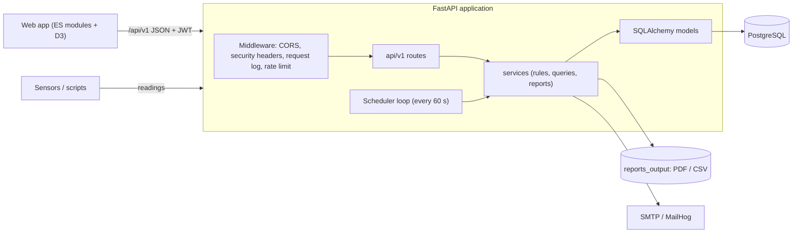

# Architecture

## Layers

| Layer | Folder | Rule |
|---|---|---|
| Routes | `src/app/api/v1` | Parse the request, check the role, call a service, return a schema. No business logic. |
| Schemas | `src/app/schemas` | Validation and sanitization of input; the shape of output. |
| Services | `src/app/services` | Business rules and queries. `analytics.py`, `schedule.py` and `report_render.py` are pure functions (easy to test). |
| Models | `src/app/models` | Tables; kept in step with `db/migrations`. |
| Core | `src/app/core` | Settings, security (hashing, JWT), middleware, rate limiter, scheduler. |

## Key flows

**Login and refresh:** `POST /auth/login` returns a 15-minute access token (JWT) and a single-use refresh token (only its hash is stored). The web app's API client refreshes automatically on a `401` and shares one refresh between parallel requests.

**Registration:** the account starts inactive; a signed link (24 h) opens `/ui/#/verify`, which calls `GET /auth/verify-email`. Only the first verification activates the account.

**Dashboard:** the page polls `/dashboard/summary` and `/dashboard/timeseries` every 5 s (paused when the tab is hidden). The server groups readings into minute, hour or day buckets (`analytics.bucketize`); D3 draws them.

**Reports:** `POST /reports` stores a `pending` row and returns `202`; a background task builds the file with ReportLab or `csv`, stores it under `reports_output/`, and marks it `ready`. A schedule is a row with `scheduled=true`; the scheduler claims due rows with an atomic `UPDATE`, so several workers never run the same schedule twice. Expired reports are deleted by the same loop.

**Access control:** admins see everything; users see their own sensors and reports; guests see everything read-only. Other people's resources return `404`.

## Security measures

Passwords hashed with bcrypt; signed, expiring tokens; refresh-token rotation with reuse detection; server-side role checks; input sanitization (tags and control characters removed); LIKE-escaping in searches; CSV formula-injection protection in exports; report files confined to one folder; rate limiting; strict Content-Security-Policy on the web app; DOM built without `innerHTML`; production refuses a weak `JWT_SECRET`.

## Known limits

- The rate limiter keeps counters in memory per process. With several workers each has its own counters; use Redis for exact global limits.
- Time series are grouped in Python and capped at 100,000 readings per request (portable across SQLite and PostgreSQL). For very large data, group in SQL or add rollup tables.
- PDF text uses standard fonts, so characters outside Western European alphabets may not render.
- Access and refresh tokens are kept in browser storage; the CSP and safe DOM handling reduce the XSS risk, but this is the usual trade-off for single-page apps.
