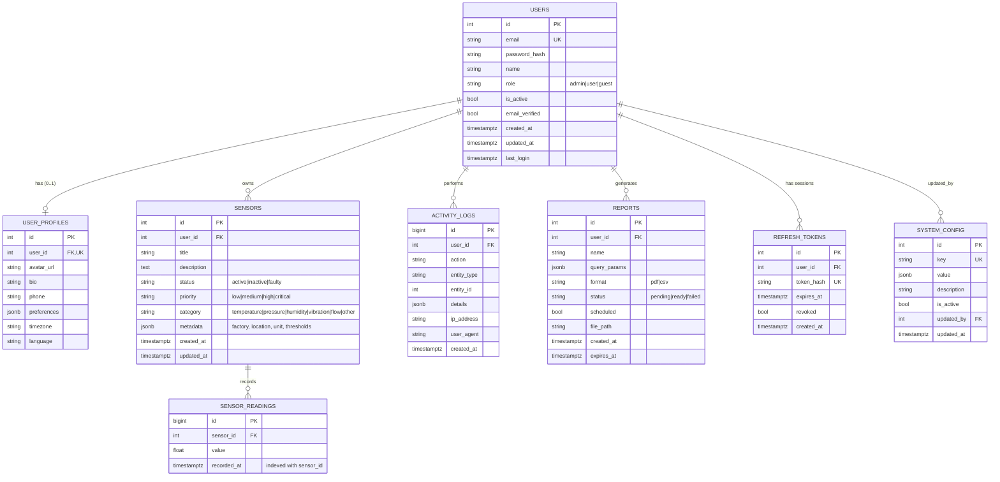

# ER Diagram

Render this file on GitHub / VS Code (Mermaid) or paste `schema.dbml` into https://dbdiagram.io.

## Design notes

- `SENSORS` is the brief's **MainEntity**. `SENSOR_READINGS` and `REFRESH_TOKENS` are additions that the brief's 6 entities don't list, but the dashboard (time-series data) and logout (session revocation) need them.
- Deleting a user cascades to their profile, sensors (and readings), reports and refresh tokens. Activity logs and `system_config.updated_by` are set to NULL instead, so the audit trail survives.
- The composite index `(sensor_id, recorded_at)` serves the dashboard's "readings for sensor X between dates" queries.
